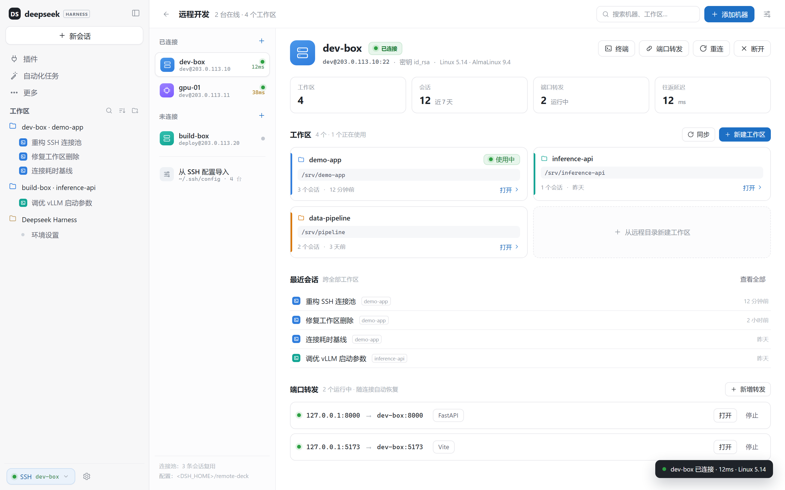
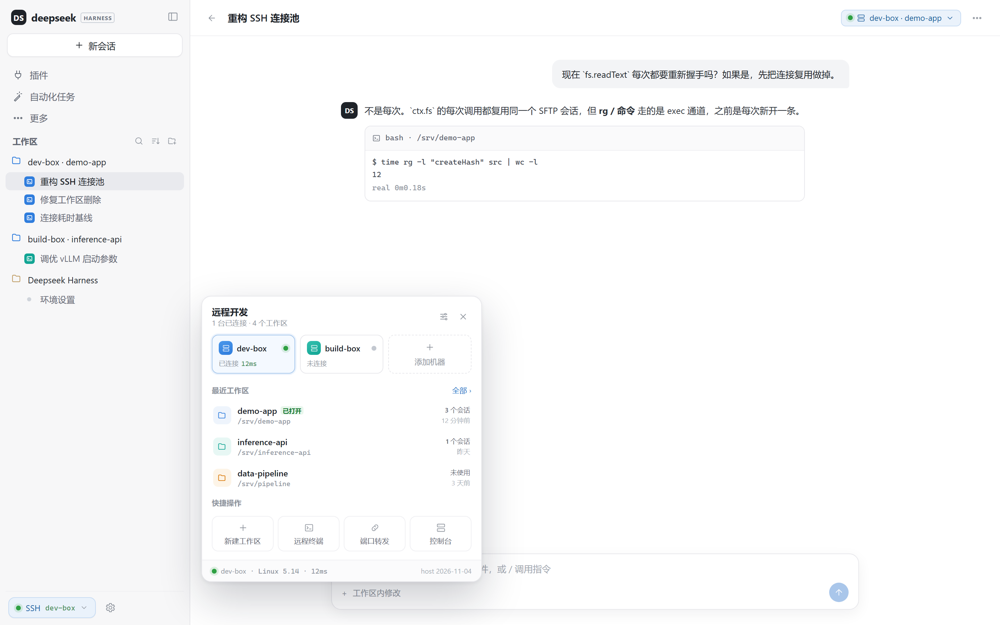
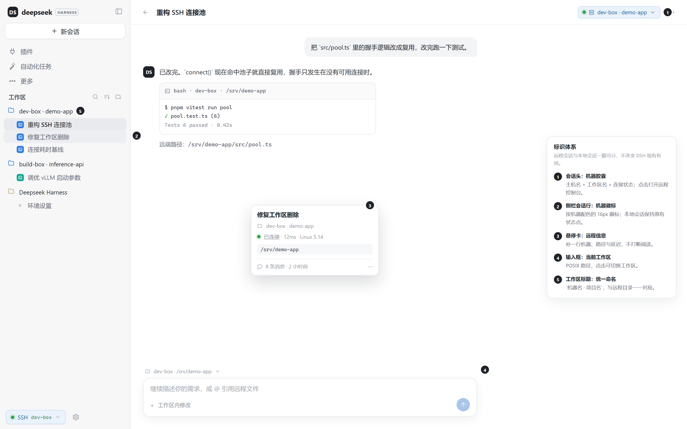
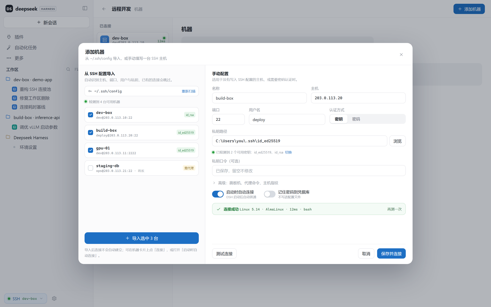
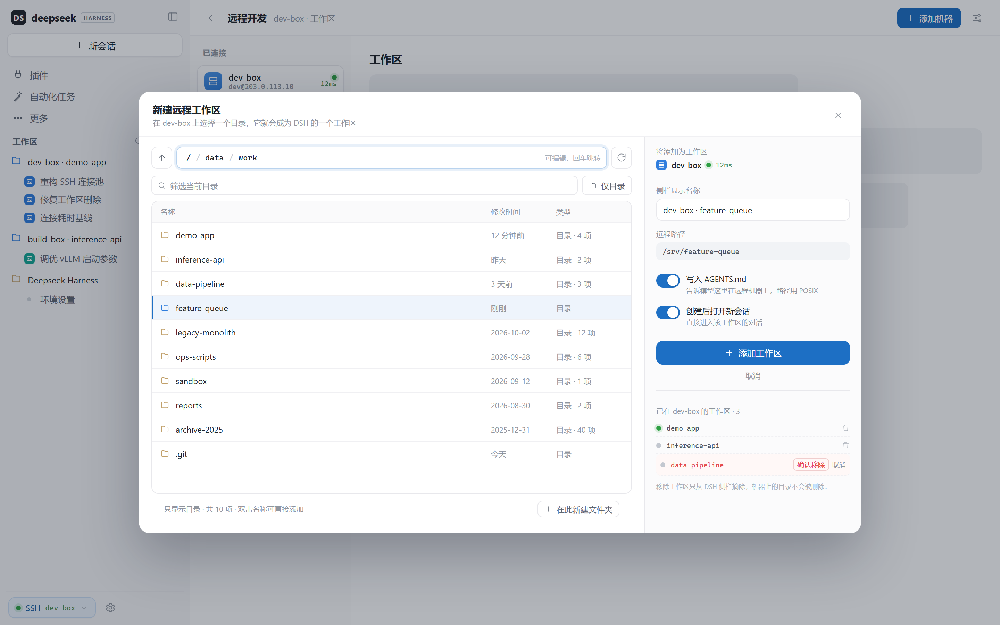
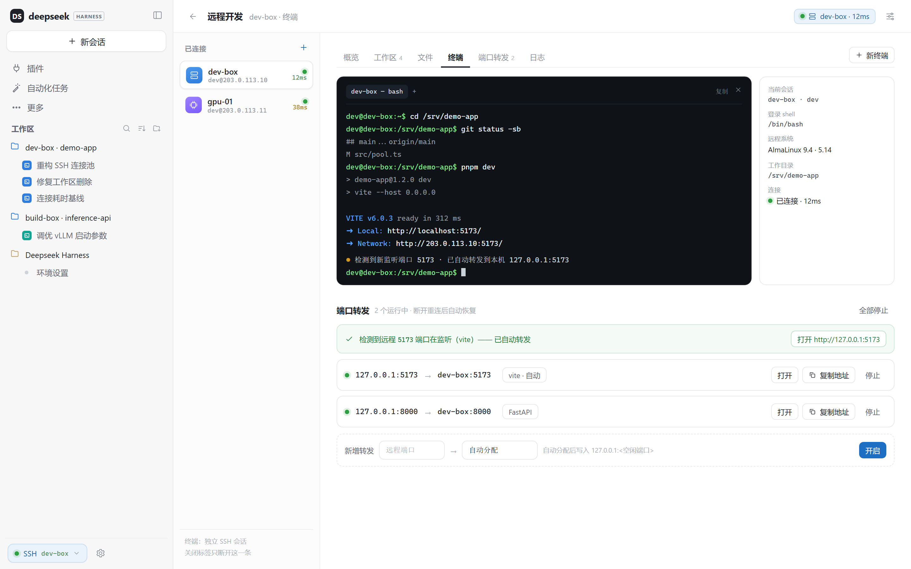

# Remote Deck

**SSH workspaces for DeepSeek Harness — one window, local and remote conversations side by side.**

Remote Deck connects your DSH desktop app to any number of SSH machines and turns a remote
folder into an ordinary DSH workspace. Inside that workspace the agent reads, writes, searches,
runs commands, opens a terminal and forwards ports on the remote host — while the UI stays the
same window you already use.

- **Conversation first.** A compact status chip, a few badges, and a console that only appears
  when you open it. Nothing competes with the chat.
- **Many machines at once.** Every host has a colour identity, its own connection, and its own
  group of workspaces and sessions.
- **No agent on the server.** Only `sshd`: SFTP for files, exec channels for commands and search,
  a PTY for the terminal, `direct-tcpip` for port forwarding.

## Screens

| Console | Quick panel |
| --- | --- |
|  |  |

| Session identity | Add a machine |
| --- | --- |
|  |  |

| New workspace | Terminal and ports |
| --- | --- |
|  |  |

Screenshots are rendered from the sanitized design mockups in `docs/design/v2/`. Host names,
addresses and paths are demo data (`dev-box`, `203.0.113.10`, `/srv/demo-app`).

## Features

| Area | What you get |
| --- | --- |
| Connections | Multiple hosts, key or password auth, `~/.ssh/config` import, connection test with OS/latency, per-host auto-connect (off by default; toggle in the dialog, quick panel or console), keepalive and backoff reconnect |
| Workspaces | Browse remote folders with breadcrumbs, filters and keyboard navigation; add one as a DSH workspace; custom sidebar name; remove locally without touching the remote directory |
| Sessions | Remote sessions get a header pill, a colour-coded sidebar badge and a hover line; local sessions are unchanged |
| Console | Machine rail, host overview, stats, workspace cards, recent sessions, search, and a remote file browser with download / save-to-local / reveal |
| Terminal | Remote PTY in a full xterm.js terminal: colours, cursor, full-screen programs, paste and replay buffer |
| Ports | Automatic discovery of remote listening ports, one-click forwarding, persistence and restore on reconnect |
| Theme | Light and dark, driven by DSH theme tokens |

## Install

From the plugin market (after listing) or npm:

```sh
dsh plugin add dsh-remote-deck
```

From GitHub:

```sh
dsh plugin add git+https://github.com/dsh-plugins-cn/dsh-remote-deck.git
```

In mainland China, use the GitHub proxy:

```sh
dsh plugin add "git+https://ghproxy.laiyouxi.com/https://github.com/dsh-plugins-cn/dsh-remote-deck.git"
```

From a checkout:

```sh
git clone https://github.com/dsh-plugins-cn/dsh-remote-deck.git
cd dsh-remote-deck
powershell -ExecutionPolicy Bypass -File .\install.ps1 -Profile desktop
```

Restart DSH (or press `Ctrl+R`) after installing; the SSH chip appears at the bottom of the
sidebar and **远程开发** appears in the sidebar navigation.

The plugin has **no npm dependencies**: `ssh2` and its small dependency tree are vendored under
`vendor/node_modules`, and the terminal assets under `vendor/xterm`. Installation therefore never
runs package build scripts.

## Migrating from `dsh-remote-ssh`

Remote Deck is the successor of `dsh-remote-ssh`.

- On first load it copies connections from `<DSH_HOME>/remote-ssh` and **reuses existing workspace
  stubs in place**, so workspaces and sessions keep their place in the sidebar.
- The old plugin keeps working until you remove it. Use one profile at a time: both plugins patch
  `ctx.fs`, so only one of them should be enabled in a profile.
- Cut over in one command (backs up `package.json` first and keeps the old plugin files for
  rollback):

  ```powershell
  .\install.ps1 -Profile desktop -RemoveOld
  ```

- Roll back at any time:

  ```powershell
  .\install.ps1 -Rollback                 # restores package.json.bak-before-deck
  ```

Data stays in `<DSH_HOME>/remote-deck` and survives plugin reinstalls.

## How it works

```text
┌────────────────────────────── DSH desktop ──────────────────────────────┐
│ conversation · sidebar · Remote Deck console                            │
│        │ ctx.fs / ctx.shell / ripgrep / tools                            │
│        ▼                                                                │
│ host half: connection pool, workspace stubs, loopback API               │
└────────┬────────────────────────────────────────────────────────────────┘
         │ SSH (ssh2): exec channels · SFTP · PTY · port forwarding
         ▼
   remote host: sshd only (Linux / macOS)
```

A remote workspace is a marked stub directory under `<DSH_HOME>/remote-deck/workspaces`; the
marker records the connection id and the remote POSIX path. Every path under a marked workspace
resolves through SFTP; commands run through an exec channel with the remote cwd; ripgrep moves to
the host; the terminal is one PTY channel; forwarding is one local listener per port.

### Remote bash behaviour

- Every call runs as a DSH background job. The foreground wait defaults to 10 minutes
  (`DSH_REMOTE_DECK_FOREGROUND_TIMEOUT_MS`); when it expires the command keeps running in the
  background and the tool returns its job id — it is never killed on timeout. Follow it with the
  built-in `job_output` / `job_list` tools and stop it with `job_kill`.
- `run_in_background: true` returns a job id immediately, for servers and long acceptance runs.
- The remote stdin is closed immediately. Interactive prompts (for example `psql` without
  `PGPASSWORD`) fail fast with their own error instead of blocking the turn forever.
- The working directory is strict. Relative paths resolve against the session workspace; a missing
  directory fails the command instead of silently falling back to the home directory.
- Output is capped at 4 MiB per stream (`DSH_REMOTE_DECK_MAX_OUTPUT_BYTES`) and marked
  `[output truncated; …]` when it exceeds the cap.
- Stopping the tool or calling `job_kill` signals the recorded remote pid (TERM, then KILL).
  Processes detached with `setsid`/double fork may survive; use `timeout` for those.

## Security

- Remote commands run on the SSH host outside the local DSH sandbox/approval layer; the remote
  account is the execution boundary. Pin the host key with `hostKeyFingerprint` on the connection
  record and use a restricted account for untrusted repositories.
- `apply_patch` is not supported on remote workspaces yet; use `edit`/`write`.
- A remote Session routes POSIX paths to the SSH host and drive/backslash paths (`C:\\...`,
  `E:\\...`) to the local machine, so remote development can still use local Windows
  files/resources. Both worlds are intentionally reachable; review remote-sourced content before
  letting it touch local paths.
- The loopback API accepts the desktop `dsh-app://app` origin and loopback HTTP(S); every route
  still requires the per-session token.

- Passwords and key passphrases live in the DSH credential store, never in `connections.json`.
- The browser half talks to the host over a loopback HTTP server guarded by a per-session token.
- The terminal and forwarding endpoints are behind the same token.
- Removing a workspace only unregisters it locally; remote files are never deleted by the plugin.

## Requirements

- DeepSeek Harness desktop 0.2.x or newer.
- Node 20+.
- `sshd` on the remote host; Linux or macOS; remote shell `bash`.

## Known limits

- The terminal ships a vendored xterm.js build (colours, cursor, full-screen programs). If the
  asset loader is blocked, the plugin falls back to a plain line renderer.
- The UI is Chinese-first; English strings land in v1.1.0.
- `~/.ssh/config` import covers Host/HostName/Port/User/IdentityFile/ProxyJump; proxy commands and
  host-key pinning are not wired into the connection dialogs yet.
- `ss` or `netstat` is required for automatic port discovery; manual forwarding still works.

## Development

```sh
npm run check        # syntax + manifest
npm test             # parser unit tests
npm run pack:dry     # inspect the published file list
```

Design mockups and their sanitized renders live in `docs/design/v2/`; acceptance runs are
recorded in the CHANGELOG. The version plan is in [ROADMAP.md](ROADMAP.md), release steps in
[PUBLISH.md](PUBLISH.md), and the iteration runbook in [docs/MAINTENANCE.md](docs/MAINTENANCE.md).

## License

MIT

## Release policy

See [RELEASE-POLICY.md](./RELEASE-POLICY.md): batch fixes, test before publishing, and use semantic versions (patch = bugfix, minor = capability).
